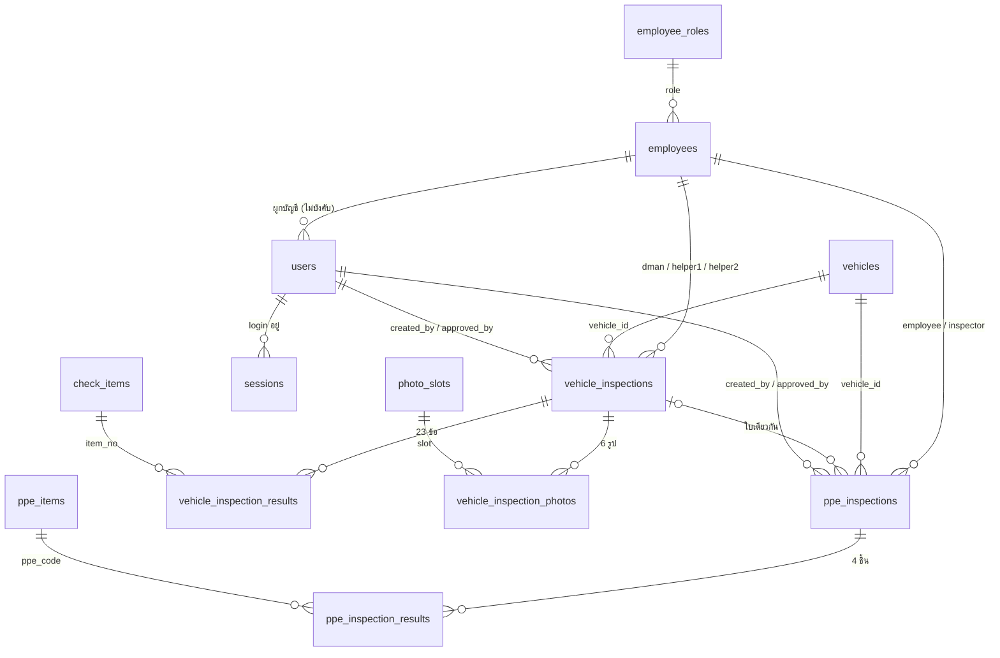
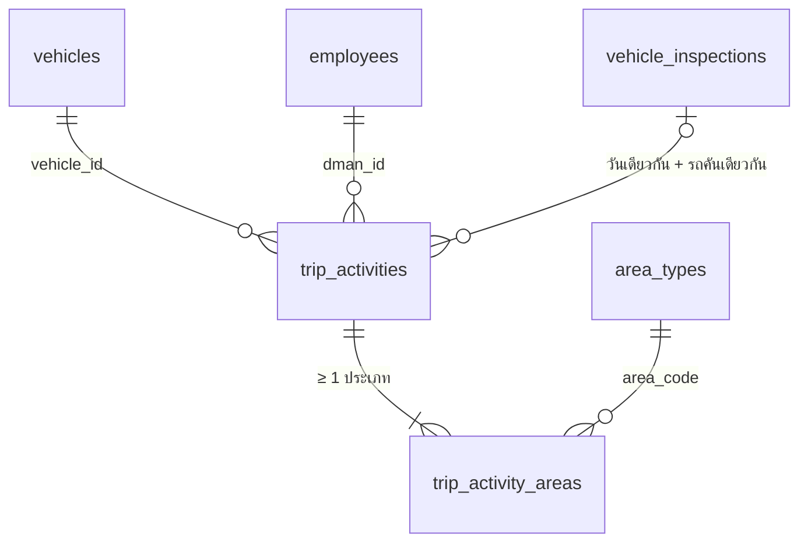

# ฐานข้อมูลบน Cloudflare · Pre-Trip PPE Check

ออกแบบจากไฟล์ `Piyachart54_PreTrip_PPE_Admin_BI_v2.xlsx` (7 ชีต) และ schema Supabase รุ่นแรกของโปรเจกต์ (ลบออกแล้ว ดูได้ใน git history)

| ส่วน | บริการ Cloudflare | หน้าที่ |
|---|---|---|
| ฐานข้อมูล | **D1** (SQLite) | ตาราง, view สำหรับรายงาน |
| รูปถ่าย 6 มุม | **R2** bucket (private) | เก็บไฟล์รูป ส่วน D1 เก็บแค่ key |
| API | **Worker** + Static Assets | เสิร์ฟหน้าเว็บ Vite, ตรวจสิทธิ์, รัน SQL ผ่าน `db.batch()` |
| Login | **Worker เอง** (id_user + รหัสผ่าน) | รหัสผ่านเก็บแบบ PBKDF2, session เป็น cookie HttpOnly — ไม่ต้องมีบัญชี Cloudflare |

ไฟล์ migration (รันตามลำดับชื่อ):

| ไฟล์ | เนื้อหา |
|---|---|
| [`migrations/0001_schema.sql`](migrations/0001_schema.sql) | 15 ตาราง, 16 index, 23 trigger (`updated_at`, ล็อกเอกสารที่อนุมัติแล้ว, ความสอดคล้อง PPE↔รถ) |
| [`migrations/0002_views.sql`](migrations/0002_views.sql) | 10 view: สรุปรายใบ, รายวัน, BI รายคน/ทั้งทีม, ตรวจเลขไมล์ |

ทดสอบแล้วบน D1 local (wrangler 4.162.0): `wrangler d1 migrations apply --local` ผ่านทั้ง 3 ไฟล์ และชุดทดสอบ 34 กรณีผ่าน `db.batch()` จริงผ่านทั้งหมด (constraint, trigger ล็อก, upsert, rollback เมื่อ batch ล้ม, ผลของ view)
| [`migrations/0003_seed.sql`](migrations/0003_seed.sql) | รหัสผล, ตำแหน่ง, 23 ข้อตรวจรถ, 4 PPE, 6 ช่องรูป, EMP01–EMP06 (ตัวอย่าง — ระบบจริง import รายชื่อจริงแทนแล้ว) |
| [`migrations/0004_roles_admin_user.sql`](migrations/0004_roles_admin_user.sql) | สิทธิ์เหลือ `admin` / `user` · รหัสที่ admin ตั้งไม่บังคับเปลี่ยน |
| [`migrations/0005_trip_activities.sql`](migrations/0005_trip_activities.sql) | Time activities: ประเภทพื้นที่ 7 แบบ, บันทึกก่อนออกงาน, ความสัมพันธ์หลายต่อหลาย, view รายงาน |

---

## 1. ความสัมพันธ์ของตาราง



Excel เก็บแบบ **กว้าง** (1 แถวมี 23 คอลัมน์ผล) แต่ในฐานข้อมูลเก็บแบบ **หัว + รายละเอียด** (ผล 1 ข้อ = 1 แถว) เพราะ:
- เพิ่มหรือปิดรายการตรวจได้โดยไม่ต้องแก้โครงสร้างตาราง
- แยก "ยังไม่กรอก" (ไม่มีแถว) ออกจาก "ไม่ผ่าน" (มีแถว result = 2) ได้ชัดเจน ตรงกับกติกาในชีต วิธีใช้
- view `v_vehicle_inspection_summary` จะคืนค่าเป็น 1 แถวต่อใบเหมือนชีต DATA รถ ให้อยู่แล้ว

---

## 2. พจนานุกรมข้อมูล

ข้อตกลงที่ใช้ทุกตาราง: เป็น `STRICT` ทั้งหมด (บังคับชนิดข้อมูลจริง) · boolean ใช้ `INTEGER 0/1` · วันที่ใช้ `TEXT 'YYYY-MM-DD'` ตามเวลาไทย · timestamp ใช้ ISO-8601 UTC · id ใช้ hex 32 ตัว (หรือ Worker ส่ง UUID มาเองก็ได้)

### 2.1 ข้อมูลหลัก (master)

**`employees`** ← ชีต ตั้งค่า!A:D
| คอลัมน์ | ชนิด | กติกา | ที่มาใน Excel |
|---|---|---|---|
| `id` | TEXT PK | 1–20 ตัว ต้องเป็นตัวพิมพ์ใหญ่และไม่มีช่องว่างหน้าหลัง เช่น `EMP01` | A รหัสพนักงาน |
| `name` | TEXT | ห้ามมีช่องว่างหน้าหลัง | B ชื่อ-นามสกุล |
| `role` | TEXT FK → `employee_roles` | NULL = ยังไม่ระบุ | C ตำแหน่ง (D-Man, Helper, ธุรการ, อื่น ๆ) |
| `requires_ppe` | 0/1 | 0 = ไม่ต้องตรวจ PPE รายวัน | ใหม่ |
| `active` | 0/1 | | D สถานะ "ใช้งาน" |
| `active_from`, `active_to` | DATE | ช่วงวันที่ต้องตรวจ ใช้คำนวณว่า "ยังไม่ตรวจ" ในอดีตได้ถูกต้อง | ใหม่ |

**`vehicles`** ← ตั้งค่า!F:G
| คอลัมน์ | กติกา |
|---|---|
| `id` | PK (ใบตรวจอ้างถึงรถด้วย id ไม่ใช่ทะเบียน จึงแก้ทะเบียนได้โดยประวัติไม่หาย) |
| `plate` | UNIQUE |
| `plate_key` | generated column ที่ตัด ช่องว่าง/`-`/`.` ออก และเป็น UNIQUE เพื่อกัน "70-1234" กับ "70 1234" ซ้ำกัน |
| `type`, `active`, `active_from`, `active_to` | เหมือนกับ employees |

**`check_items`** (23 ข้อ) · **`ppe_items`** (4 ชิ้น) · **`photo_slots`** (6 ช่อง) · **`result_codes`** · **`employee_roles`** · **`non_working_days`** (วันหยุด ไม่นับเป็น "ยังไม่ตรวจ")

### 2.2 ใบตรวจรถ: `vehicle_inspections` ← ชีต DATA รถ (1 แถว = รถ 1 คัน / 1 วัน)
| คอลัมน์ | กติกา | Excel |
|---|---|---|
| `inspect_date` | ต้องเป็นวันที่จริง (`2026-02-30` ไม่ผ่าน) | A วันที่ |
| `month` | generated `YYYY-MM` | B เดือน (สูตร) |
| `inspect_time` | `HH:MM` หรือ `HH:MM:SS` | G เวลาตรวจ |
| `vehicle_id` | FK, NOT NULL | E ทะเบียนรถ |
| `mileage` | 0–9,999,999 | F เลขไมล์ |
| `dman_id`, `helper1_id`, `helper2_id` | FK; ทั้งสามคนต้องไม่ซ้ำกัน; จะมี helper2 ได้ต้องมี helper1 ก่อน | C รหัส D-Man (D ชื่อ = join) |
| `declared_result` | 1/2 หรือ NULL — ผลที่ D-Man ติ๊กบนกระดาษ | I ผลตรวจ 1/2 |
| `line_photo_sent` | 1/2 หรือ NULL | H ส่งภาพ LINE 1/2 |
| `note` | | J ข้อบกพร่อง/หมายเหตุ |
| `source` | `app` / `paper` / `import` | แยกข้อมูลที่คีย์จากกระดาษ |
| `approved_by`, `approved_at` | ต้องมีทั้งคู่หรือไม่มีทั้งคู่ | PRINT "ลงชื่อหัวหน้า" |
| `created_by`, `updated_by` | FK → `users.id` (id_user) | |

UNIQUE `(inspect_date, vehicle_id)` ทำให้รถ 1 คันมีใบตรวจได้ 1 ใบต่อวันเหมือนใน Excel

**`vehicle_inspection_results`** ← DATA รถ!K:AG: PK `(inspection_id, item_no)` · `result` ∈ {1,2,3} · `remark` สำหรับรายละเอียดข้อบกพร่องรายข้อ
**`vehicle_inspection_photos`**: PK `(inspection_id, slot)` · `r2_key` UNIQUE · ชนิดไฟล์ jpeg/png/webp · ขนาดไม่เกิน 5 MB

### 2.3 ใบ PPE: `ppe_inspections` ← ชีต DATA PPE (1 แถว = พนักงาน 1 คน / 1 วัน)
| คอลัมน์ | Excel |
|---|---|
| `inspect_date`, `month` | A, B |
| `employee_id` (FK) | C (D ชื่อ, E ตำแหน่ง = join) |
| `inspector_id` (FK) | G ผู้ตรวจ D-Man |
| `vehicle_id` (FK, ไม่บังคับ) | F ทะเบียนรถ |
| `vehicle_inspection_id` | ผูกกับใบตรวจรถที่วันเดียวกันและรถคันเดียวกัน (trigger บังคับให้ตรงกัน) |
| `note`, `source`, `approved_*`, `created_by`… | เหมือนกับใบตรวจรถ |

UNIQUE `(inspect_date, employee_id)` · **`ppe_inspection_results`**: `result` ∈ {1,2}

### 2.4 ระบบ
- **`users`**: id_user (a-z 0-9 . _ - ยาว 3–32), ชื่อที่แสดง, `role` (`admin` หรือ `user`), `password_hash` (PBKDF2-SHA256 100,000 รอบ + salt), ต้องเปลี่ยนรหัสหรือไม่, จำนวนครั้งที่ใส่ผิด, ล็อกถึงเมื่อไหร่ · ผูกกับ `employee_id` ได้
- **`sessions`**: เก็บ **SHA-256 ของ token** (ไม่เก็บ token จริง) + วันหมดอายุ · **`login_throttle`**: นับครั้งที่ลอง login ต่อ IP
- **`audit_log`**: Worker เขียนบันทึกลงตารางนี้ใน `db.batch()` เดียวกับการบันทึกข้อมูล (`detail` ต้องเป็น JSON ที่ถูกต้อง)

---

## 3. กติกาที่ฐานข้อมูลบังคับเอง

| กติกา | ทำด้วย |
|---|---|
| รหัสผลรถต้องเป็น 1/2/3 และ PPE ต้องเป็น 1/2 | CHECK |
| วันที่/เวลาต้องถูกรูปแบบและมีอยู่จริง | CHECK `date(x) IS x` (ใช้ `IS` เพราะ CHECK ที่ได้ค่า NULL จะถือว่าผ่าน) |
| 1 รถ / 1 วัน และ 1 คน / 1 วัน | UNIQUE |
| ลูกเรือ 3 คนต้องไม่ซ้ำกัน | CHECK |
| ลบพนักงาน รถ หรือรายการตรวจที่มีประวัติอยู่ไม่ได้ (ให้ตั้ง `active = 0` แทน) | FK `ON DELETE RESTRICT` |
| ลบใบตรวจแล้วผลรายข้อและรูปถูกลบตามไปด้วย | FK `ON DELETE CASCADE` |
| ใบที่หัวหน้าอนุมัติแล้วแก้หรือลบไม่ได้ จนกว่าจะยกเลิกอนุมัติ | trigger `trg_*_lock_*` (error ขึ้นต้นด้วย `LOCKED:`) |
| ใบ PPE ที่ผูกกับใบตรวจรถต้องเป็นวันเดียวกันและรถคันเดียวกัน | trigger (error ขึ้นต้นด้วย `PPE_VEHICLE_MISMATCH:`) |
| `updated_at` อัปเดตอัตโนมัติ | trigger `trg_*_touch` |

Worker ต้องตรวจเอง (เพราะ SQLite ใช้ `date('now')` ใน CHECK ไม่ได้):
- วันที่ตรวจต้องไม่อยู่ในอนาคต
- ผู้ใช้ต้องมี session ที่ยังไม่หมดอายุ และบัญชี `active = 1`
- เฉพาะ `admin` เท่านั้นที่อนุมัติได้

---

## 4. View สำหรับหน้าเว็บและรายงาน

| View | 1 แถว = | เทียบกับ Excel |
|---|---|---|
| `v_vehicle_inspection_summary` | ใบตรวจรถ | DATA รถ ทั้งแถว รวมคอลัมน์สูตร AH:AL |
| `v_ppe_inspection_summary` | ใบ PPE | DATA PPE รวมคอลัมน์สูตร L:O |
| `v_vehicle_item_results`, `v_ppe_item_results` | ผล 1 ข้อ | ใช้ทำ Power BI / Looker Studio |
| `v_daily_vehicle_status` | รถ × วัน (รวมคันที่ยังไม่ตรวจ) | — |
| `v_daily_ppe_status` | คน × วัน (รวมคนที่ยังไม่ตรวจ) | — |
| `v_daily_summary` | วัน | — |
| `v_employee_daily_activity` | คน × วัน (เฉพาะวันที่มีข้อมูล) | ตาราง BI รายคน!A11:H |
| `v_employee_monthly_summary` | คน × เดือน | BI รายคน!A7:H8 และ สรุปทั้งทีม |
| `v_mileage_check` | ใบตรวจรถ | ใหม่: เตือนเมื่อเลขไมล์ลดลงจากครั้งก่อน |

**ผลรวมของรถ (`overall_result`)** ทำตามชีต วิธีใช้ ที่ระบุว่า "ช่องว่าง = ยังไม่ตรวจ ไม่ถือว่าผ่าน":
- `2` ไม่ผ่าน เมื่อมีข้อใดเป็น 2 **หรือ** D-Man ติ๊กไม่ผ่านบนกระดาษ (ถ้าขัดกันให้ถือว่าไม่ผ่านไว้ก่อนเพื่อความปลอดภัย)
- `1` ผ่าน เมื่อกรอก **ครบทุกข้อ** ที่ active และไม่มีข้อไหนเป็น 2
- `NULL` เมื่อยังกรอกไม่ครบ · ถ้าผลที่ติ๊กบนกระดาษขัดกับผลรายข้อ คอลัมน์ `result_mismatch = 1`

> ⚠️ แอปเวอร์ชันปัจจุบันถือว่า "ไม่มีข้อไหนเป็น 2 = ผ่าน" แม้กรอกไม่ครบ แต่ view นี้ตั้งใจให้เข้มกว่าเพื่อให้ตรงกับ Excel

**สถานะ PPE** (DATA PPE!O): กรอกไม่ครบ → `ไม่ครบ` · มีชิ้นที่ไม่มี → `อุปกรณ์ไม่ครบ` · นอกนั้น → `ครบ`

**"วันนี้"** ใน view คำนวณจาก `date('now', '+7 hours')` (เวลาไทย) · คอลัมน์ `results`, `photos`, `fail_items`, `missing_items` เป็นข้อความ JSON ที่ Worker ต้อง `JSON.parse` ก่อนใช้

---

## 5. Worker API (`worker/`)

| ไฟล์ | หน้าที่ |
|---|---|
| `worker/index.ts` | router, ตรวจ CSRF, แปลง error เป็นข้อความภาษาไทย, cron ล้างรูปค้าง |
| `worker/auth.ts` | session cookie, ตรวจสิทธิ์, จำกัดการลอง login ต่อ IP |
| `worker/auth-routes.ts` | login / logout / ตั้งค่าครั้งแรก / เปลี่ยนรหัส / จัดการผู้ใช้ |
| `worker/password.ts` | PBKDF2 hash + ตรวจรหัสแบบเวลาคงที่ + กติการหัสผ่าน |
| `worker/routes.ts` | endpoint ทั้งหมด |
| `worker/validate.ts` | ตรวจข้อมูลขาเข้า (วันที่, เวลา, เลขไมล์, รหัส ฯลฯ) |
| `src/lib/api.cloudflare.ts` | ฝั่งหน้าเว็บ: function ชุดเดียวกับ `api.mock.ts` แต่เรียก `/api/*` |

### สิทธิ์ผู้ใช้ (`users.role`)

| role | ทำได้ |
|---|---|
| `user` | พนักงานทุกคน: ดูข้อมูล รูป รายงาน + บันทึก/แก้/ลบ ใบตรวจรถ ใบ PPE และรูป · **ไม่เห็นแท็บตั้งค่า** |
| `admin` | ทุกอย่าง: + แท็บตั้งค่า (พนักงาน/รถ) + อนุมัติ + จัดการผู้ใช้ (เพิ่ม, เปลี่ยนสิทธิ์, ปิดบัญชี, ปลดล็อก, ตั้งรหัสผ่านใหม่) |

### Login
- **ตั้งค่าครั้งแรก:** ตอนที่ยังไม่มีผู้ใช้เลย หน้าเว็บจะให้สร้าง admin คนแรก (`POST /api/auth/setup`) — มีผู้ใช้แล้วจะปิดถาวร
- **รหัสผ่าน:** ≥ 8 ตัว, ห้ามมีชื่อผู้ใช้, ห้ามเดาง่าย · รหัสที่ admin ตั้งให้ (ตอนเพิ่มผู้ใช้หรือตั้งรหัสใหม่) **ใช้ได้เลย ไม่บังคับเปลี่ยน** · ผู้ใช้เปลี่ยนเองได้ที่ปุ่ม "เปลี่ยนรหัสผ่าน"
- **กันเดารหัส:** ผิด 5 ครั้ง ล็อกบัญชี 15 นาที (admin ปลดล็อกได้) · ต่อ IP ลองได้ 30 ครั้ง / 15 นาที · ผู้ใช้ที่ไม่มีอยู่จริงตอบข้อความเดียวกันและใช้เวลาเท่ากัน
- **Session:** cookie `__Host-pt_session` (HttpOnly, Secure, SameSite=Lax) อยู่ได้ 7 วันนับจากครั้งล่าสุดที่ใช้ · เปลี่ยนรหัส = เครื่องอื่นหลุด · ปิดบัญชี/เปลี่ยนสิทธิ์/ตั้งรหัสใหม่ = หลุดทุกเครื่อง
- ต้องมี admin ที่ใช้งานได้อย่างน้อย 1 คนเสมอ

### Endpoint

| Method | Path | สิทธิ์ขั้นต่ำ | หมายเหตุ |
|---|---|---|---|
| GET | `/api/auth/status` | — | ต้องตั้งค่าครั้งแรกไหม / ใคร login อยู่ |
| POST | `/api/auth/setup` | — | สร้าง admin คนแรก (ใช้ได้เฉพาะตอนยังไม่มีผู้ใช้) |
| POST | `/api/auth/login` | — | `{username, password}` → ตั้ง cookie |
| POST | `/api/auth/logout` | — | ลบ session |
| POST | `/api/auth/password` | ทุกคน | `{current_password, new_password}` |
| GET | `/api/me` | user | ผู้ใช้ที่ login อยู่ |
| GET / POST | `/api/users` | admin | รายชื่อ / เพิ่มผู้ใช้ `{id, display_name, role, employee_id, password}` |
| PUT | `/api/users/:id` | admin | `{display_name, role, active, employee_id, unlock}` |
| POST | `/api/users/:id/reset-password` | admin | ตั้งรหัสผ่านใหม่ (ใช้ได้ทันที, เครื่องอื่นของผู้ใช้นั้นหลุด) |
| GET | `/api/master` | user | พนักงาน, รถ, 23 ข้อ, PPE, ช่องรูป, ตำแหน่ง |
| PUT | `/api/employees/:id` | admin | เพิ่ม/แก้พนักงาน `{name, role, active}` |
| PUT | `/api/vehicles` | admin | เพิ่ม/แก้รถ `{id?, plate, type, active?}` — เพิ่มทะเบียนที่เคยลบ = เปิดใช้งานคืนพร้อมประวัติ |
| DELETE | `/api/vehicles/:id` | admin | ถ้ามีประวัติจะ **ปิดใช้งาน** แทนการลบ |
| GET | `/api/vehicle-inspections?date=` หรือ `?month=` | user | ต้องระบุอย่างใดอย่างหนึ่ง |
| POST | `/api/vehicle-inspections` | user | บันทึก/แก้ (มี `id` = แก้ใบนั้น, ไม่มี = upsert ตามวัน+รถ) |
| DELETE | `/api/vehicle-inspections/:id` | user | ลบใบ + รูปใน R2 |
| POST / DELETE | `/api/vehicle-inspections/:id/approval` | admin | อนุมัติ / ยกเลิกอนุมัติ |
| GET | `/api/ppe-inspections?date=` หรือ `?month=` | user | |
| POST | `/api/ppe-inspections` | user | บันทึกหลายคนพร้อมกัน (ทั้งชุดสำเร็จหรือไม่สำเร็จด้วยกัน) |
| DELETE | `/api/ppe-inspections/:id` | user | |
| POST / DELETE | `/api/ppe-inspections/:id/approval` | admin | |
| GET | `/api/trip-activities?date=` หรือ `?month=` | user | บันทึกก่อนออกงาน + ประเภทพื้นที่ |
| POST | `/api/trip-activities` | user | `{id?, date, time, plate, dman, areas: [code...], note}` — ต้องเลือกพื้นที่ ≥ 1 · 1 รถ/วัน (ไม่มี id = upsert ตามวัน+รถ) |
| DELETE | `/api/trip-activities/:id` | user | ลบเที่ยวและประเภทพื้นที่ของเที่ยวนั้น |
| POST | `/api/photos?date=YYYY-MM-DD` | user | body = ไฟล์รูป ≤ 5 MB, ตรวจชนิดจาก byte จริง (JPEG/PNG/WebP) |
| GET | `/api/photos/<key>` | user | ส่งรูปจาก R2 (เบราว์เซอร์ถามใหม่ทุกครั้งผ่าน ETag → รูปที่ลบแล้วหายทันที) |
| POST | `/api/photos/delete` | user | `{keys: [...]}` ลบเฉพาะรูปที่ **ไม่ได้** อยู่ในใบตรวจใด |
| GET | `/api/reports/<ชื่อ>.csv` หรือ `.json` `?month=` | admin | สำหรับ Excel / Power BI (ดูรายชื่อด้านล่าง) |

รายงาน: `daily-summary`, `daily-vehicle-status`, `daily-ppe-status`, `employee-daily`, `employee-monthly`,
`vehicle-inspections`, `ppe-inspections`, `vehicle-item-results`, `ppe-item-results`, `mileage-check`,
`trip-activities`, `trip-area-results`, `trip-area-monthly`
(CSV มี BOM เปิดใน Excel ภาษาไทยไม่เพี้ยน และกัน formula injection แล้ว)

### กติกาที่ API บังคับเพิ่มจากฐานข้อมูล
- วันที่ตรวจต้องไม่อยู่ในอนาคต (เวลาไทย) · ทะเบียนเทียบแบบไม่สนช่องว่าง/ขีด/จุด (`70 1234` = `70-1234`)
- ทะเบียนที่ยังไม่ลงทะเบียน → แจ้งให้เพิ่มที่แท็บตั้งค่า · รถที่ปิดใช้งานแล้วเปิดใบใหม่ไม่ได้ (แก้ใบเก่าได้)
- มีแต่ Helper 2 → ระบบย้ายเป็น Helper 1 ให้ · รูปทุกรูปที่อ้างถึงต้องมีอยู่จริงใน R2
- ใบที่อนุมัติแล้วแก้/ลบไม่ได้ (ตอบ 409) · รูปที่ถูกเอาออกจากใบจะถูกลบจาก R2 ให้อัตโนมัติ
- **ปลอดภัย:** ทุก endpoint ยกเว้น `/api/auth/*` ต้อง login · คำขอที่เปลี่ยนข้อมูลต้องมี header `x-requested-with: pretrip`
  และมาจาก origin เดียวกัน (กัน CSRF) · error ภายในไม่ถูกส่งรายละเอียดออกไป (log ไว้ใน Workers Logs)
- ทุกการแก้ไขบันทึกลง `audit_log` ใน batch เดียวกับข้อมูล
- Cron ทุกวัน 03:00 (ไทย) ลบรูปที่อัปโหลดเกิน 24 ชม. แต่ไม่ได้อยู่ในใบตรวจใด

### ทดสอบที่ทำแล้ว
- API แบบ end-to-end บน D1/R2 local (`wrangler dev`): **93 กรณีผ่านทั้งหมด** — validation, สิทธิ์, CSRF, upsert, ล็อกอนุมัติ, การผูก PPE↔ใบตรวจรถ, รูป, รายงาน
- Login / session / จัดการผู้ใช้: **34 กรณีผ่าน** — รหัสเก็บเป็น hash, token เก็บเป็น hash, สิทธิ์ admin/user, รหัสที่ admin ตั้งใช้ได้ทันที, ล็อกหลังผิด 5 ครั้ง, logout, session หมดอายุ, cookie ปลอม, ปิดบัญชี, ตั้งรหัสใหม่, กัน admin คนสุดท้าย
- บน Cloudflare จริง: การตรวจรหัสผ่าน (PBKDF2 100,000 รอบ) ทำงานได้ในแผนฟรี (~0.2–0.4 วินาทีต่อครั้ง) · ทดสอบบันทึกรถ/ใบตรวจ/PPE/รูปจริงแล้วลบทิ้ง ผ่านครบ
- migration 0004 มีตัวกัน: ถ้ามีบันทึกที่อ้างถึงผู้ใช้อยู่แล้วจะไม่ยอมรัน (ทดสอบบน D1 local แล้ว)
- หน้าเว็บจริงต่อ API local: ตั้งค่า, ตรวจรถ + อัปโหลดรูป, PPE, ภาพรวม, ข้อมูล — ไม่มี error
- Time activities: **25 กรณีผ่าน** — validation, เรียงพื้นที่ตาม sort_order, upsert, ผูก/ปลดการผูกกับใบตรวจรถอัตโนมัติ, ห้ามซ้ำ 1 รถ/วัน, ประเภทที่ปิดใช้งาน, รถที่มีประวัติถูกปิดแทนลบ, รายงาน, audit log · migration 0005 รันทับฐานข้อมูลที่มีข้อมูลอยู่แล้วได้

---

## 6. รันในเครื่อง และ deploy

### รันในเครื่อง (ข้อมูลจริงแบบ local)
```bash
npm run db:migrate:local
```
```bash
npm run dev:api
```
แล้วเปิดอีก terminal:
```bash
npm run dev:cf
```
เปิด http://localhost:5174 ครั้งแรกจะเจอหน้า "ตั้งค่าครั้งแรก" ให้สร้าง admin ของเครื่องตัวเอง
(`npm run dev` ธรรมดา = โหมดทดสอบ เก็บข้อมูลในเบราว์เซอร์ ไม่มี login ไม่แตะ API)

### Deploy
```bash
npm run deploy
```
- ถ้าแก้ migration ใหม่: `npm run db:migrate:remote` ก่อน deploy · ถ้าแก้ `wrangler.toml`: `npm run cf-types`
- เว็บจริงตอนนี้: https://dtrip.heyrockydev.com (ลิงก์เดิม workers.dev ปิดแล้ว 2026-11-25) — ไม่ได้ใช้ Cloudflare Access แล้ว (login ผ่านแอป)
- ลืมรหัสผ่าน: admin ตั้งรหัสผ่านใหม่ให้ที่แท็บตั้งค่า → ผู้ใช้งานระบบ (ใช้ได้ทันที)
- admin ลืมรหัสเองและไม่มี admin คนอื่น: ให้ผู้ดูแลเครื่องรันคำสั่ง SQL ใน D1 Console ตั้ง `password_hash` ใหม่ (ควรมี admin อย่างน้อย 2 คนกันกรณีนี้)

---

## 6.5 Time activities (บันทึกก่อนออกงาน)



| ตาราง | 1 แถว = | กติกา |
|---|---|---|
| `area_types` | ประเภทพื้นที่ | `code` ถาวร (remote, mountain, urban_dense, suburban_dense, easy_access, narrow_road, road_works) · ปิดใช้งานด้วย `active = 0` · ลบไม่ได้ถ้ามีเที่ยวใช้อยู่ |
| `trip_activities` | รถ 1 คัน / 1 วัน | เวลาออกงาน (บังคับ), D-Man, หมายเหตุ ≤ 1000 ตัว · UNIQUE (วัน, รถ) · `vehicle_inspection_id` ชี้ใบตรวจรถวันเดียวกันของรถคันเดียวกันเท่านั้น (trigger บังคับ) |
| `trip_activity_areas` | เที่ยว × ประเภท | PK (เที่ยว, ประเภท) ห้ามซ้ำ · ลบเที่ยว = ลบประเภทของเที่ยวด้วย |

- บันทึกเที่ยวก่อนหรือหลังใบตรวจรถก็ได้ — ระบบผูกให้อัตโนมัติ และปลดการผูกเองเมื่อใบตรวจรถถูกย้ายวัน/รถ หรือถูกลบ
- ประเภทที่ปิดใช้งานแล้วเลือกใหม่ไม่ได้ แต่เที่ยวเก่าที่มีอยู่แก้ไขต่อได้
- View: `v_trip_activity_summary` (1 แถว/เที่ยว พร้อมชื่อพื้นที่), `v_trip_area_results` (แบบยาวสำหรับ BI), `v_trip_area_monthly` (จำนวนเที่ยว/คัน/คนต่อประเภทต่อเดือน)

---

## 7. ข้อจำกัดของ D1 ที่ต้องรู้

| เรื่อง | ค่า | ผลกับระบบนี้ |
|---|---|---|
| ขนาดฐานข้อมูล | 10 GB | ข้อมูล 10 คัน × 365 วัน × 23 ข้อ ≈ 84,000 แถว/ปี ซึ่งเล็กมาก |
| bind parameter ต่อคำสั่ง | 100 | ใช้ JSON + `json_each` แทนการ bind ทีละค่า |
| transaction | ใช้ `BEGIN` ไม่ได้ | ใช้ `db.batch()` แทน |
| foreign key | เปิดตลอด | ถ้าจะ import ข้อมูลที่ลำดับไม่ตรง ให้ใช้ `PRAGMA defer_foreign_keys = on` |
| สำรองข้อมูล | Time Travel ย้อนหลังได้ 30 วัน | `npx wrangler d1 time-travel restore` และ export ด้วย `wrangler d1 export` |
| เชื่อม Power BI ตรง ๆ | ไม่ได้ (ไม่มี Postgres endpoint) | ให้ Worker ทำ endpoint `/api/export/<view>.csv` หรือ export ไป Google Sheets ตามรอบเวลา |

---

## 8. ความต่างจาก schema Supabase รุ่นแรก (ลบแล้ว) และสิ่งที่ฝั่งแอปต้องแก้

| เรื่อง | Supabase | D1 |
|---|---|---|
| ใบตรวจอ้างถึงรถด้วย | `plate` (text) | `vehicle_id` (FK) แต่ view ยังคืน `plate` เหมือนเดิม |
| Supabase RPC `save_*` | function ใน Postgres | `db.batch()` ใน Worker |
| สิทธิ์การเข้าถึง | RLS + `auth.users` | ตาราง `users` + `sessions` + ตรวจใน Worker (login ด้วย id_user + รหัสผ่าน) |
| รูปภาพ | Storage + signed URL | R2 + endpoint ของ Worker |
| JSON ใน view | `jsonb` | TEXT → `JSON.parse` |
| คอลัมน์ใหม่ | — | `declared_result`, `line_photo_sent`, `source`, `approved_*`, `remark`, `requires_ppe`, `active_from/to`, `non_working_days`, `audit_log` |
| ผลรวมของรถ | ไม่มีข้อไหนเป็น 2 ถือว่าผ่าน | ต้องกรอกครบด้วยจึงจะผ่าน (ตาม Excel) |

ฝั่งแอปใช้ `src/lib/api.cloudflare.ts` (เรียก `/api/*`) มี function ชุดเดียวกับ `api.mock.ts` · ตัวสลับอยู่ที่ `src/lib/api.ts` ตามค่า `VITE_BACKEND`
